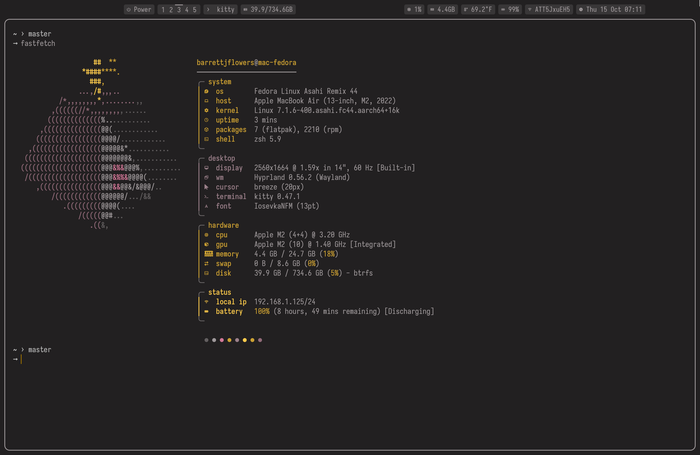

# Asahi Config

Dotfiles for my **M2 MacBook Air** running **Fedora Asahi Remix** + [Hyprland](https://hyprland.org/).

  
  

## Layout

| Dir | What |
| --- | --- |
| `asahi` | Snapshots of crontab, GRUB, fstab, packages |
| `colors` | Palette source; `colors.sh` generates every theme file |
| `css` | Injected CSS for the browser and Vivaldi |
| `hypr` | Hyprland (`hyprland.lua`), lock screen, wallpaper, scripts |
| `kitty` | Terminal, Belafonte Day |
| `nvim` | Neovim with `vim.pack`, no plugin manager |
| `rofi` | Launcher |
| `sunshine` | Moonlight streaming host |
| `swaync` | Notifications (generated) |
| `waybar` | Status bar, split around the notch |

## Changing colors

Edit the 5 hex values in `~/.config/colors/colors.sh`, then run it.
